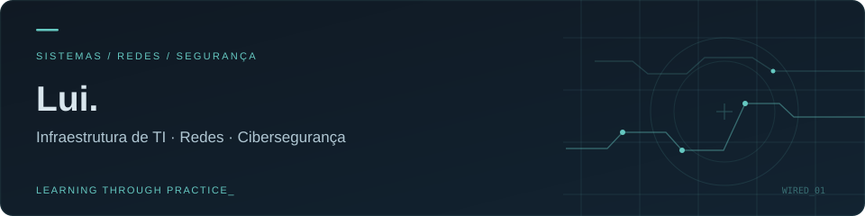
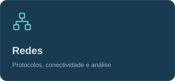

  

### Sobre mim

Sou formado em **Análise e Desenvolvimento de Sistemas**, com foco em construir uma carreira em **Infraestrutura de TI, Redes e Cibersegurança**.

Tenho formação complementar pelo **Google Cybersecurity Professional Certificate**, além de estudos e laboratórios práticos com **Linux, redes, análise de vulnerabilidades e operações de segurança**.

Utilizo este espaço para documentar meu aprendizado, desenvolver projetos e registrar experiências práticas de forma organizada.

### Áreas técnicas

  &nbsp;
  &nbsp;
  

### Projetos e laboratórios

Atualmente, estou organizando meus estudos e projetos práticos, começando por **Linux e administração de sistemas**.

Os projetos serão documentados com objetivos, procedimentos, evidências e resultados.

---

  Aprender · Aplicar · Documentar

<!-- Quando quiser adicionar o contato, substitua SEU-USUARIO pelo endereço real do LinkedIn:

  <a href="https://www.linkedin.com/in/SEU-USUARIO/">LinkedIn</a>

-->
