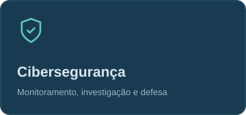

  

### Sobre mim

Sou formado em **Análise e Desenvolvimento de Sistemas**, com formação complementar pelo **Google Cybersecurity Professional Certificate** e estudos em **análise de vulnerabilidades e operações de segurança**.

Aprofundo meus conhecimentos por meio de laboratórios e exercícios práticos com **Linux, redes e ferramentas de segurança**, buscando compreender tanto o funcionamento dos sistemas quanto sua administração e proteção.

Neste GitHub, documento **procedimentos, testes, resultados e aprendizados**, construindo um registro organizado da minha evolução técnica.

### Áreas técnicas

  &nbsp;
  &nbsp;
  

### Projetos e laboratórios

Atualmente, estou organizando meus estudos e projetos práticos, começando por **Linux e administração de sistemas**.

Os projetos serão documentados com objetivos, procedimentos, evidências e resultados.

---

  Um espaço para transformar estudo em prática e prática em documentação.

  

