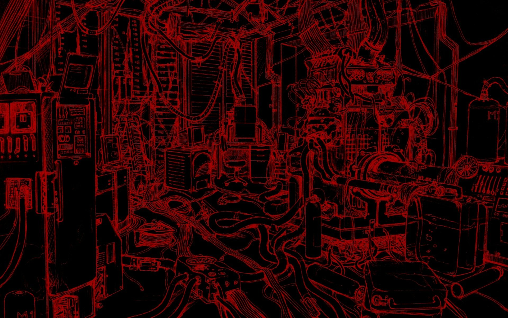

 

---

# NETWORKING

Estudos e laboratórios sobre redes de computadores, protocolos de comunicação, conectividade e análise de tráfego.

`TCP/IP` · `DNS` · `FIREWALL` · `NETWORK ANALYSIS`

---

---

### [Riot Offline Toggle](https://github.com/LuiLF/riot-offline-toggle)

Ferramenta de automação desenvolvida em Batch Script para ativar e desativar o bloqueio de conexões dos serviços sociais da Riot Games por meio de regras do Firewall do Windows.

**Conceitos aplicados:** TCP/IP, DNS, regras de firewall e automação no Windows.

---

`PROTOCOL 07 // END OF TRANSMISSION`

[← RETURN TO MAIN LAYER](https://github.com/LuiLF)

